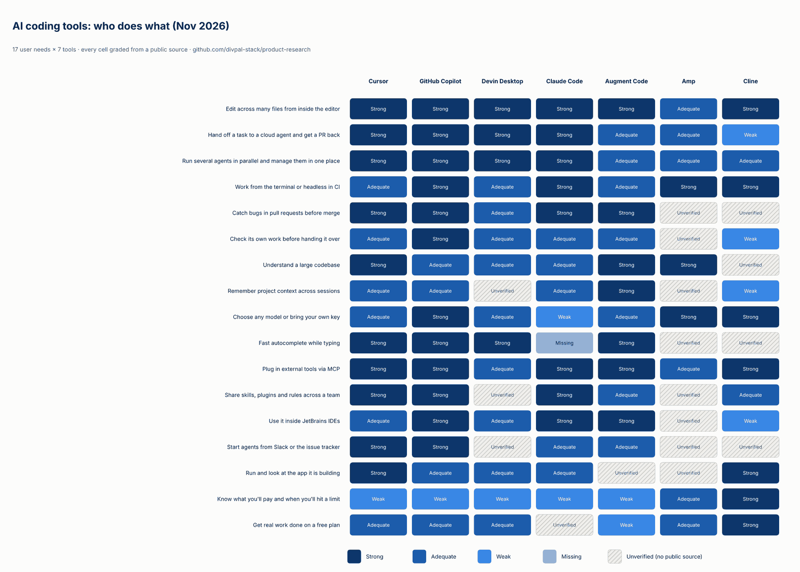

# product-research

**Competitive product-design research, as code.** Describe a product (or a single surface, like "the analytics dashboard"), and this repo's agents find the competitors, read their docs, changelogs, pricing and reviews, and give you back:

- a **feature matrix** where every cell is graded from evidence (with a source link),
- **where you win, where you lose, and where nobody is good yet**,
- a **prioritized list of features to add**, scored by gap × market coverage × user demand ÷ effort,
- a cited **report** you can drop into a PRD or roadmap review,
- **journey teardowns**: pick one job on one surface (e.g. desktop onboarding) and get stage-by-stage grades, who does each stage best, and concrete fixes per product.

### Example: [What should each AI coding tool build next? (Nov 2026)](research/examples/ai-coding-tools-2026-11/report.md)

[](research/examples/ai-coding-tools-2026-11/report.md)

Cursor, GitHub Copilot, Devin Desktop, Claude Code, Augment Code, Amp and Cline, graded on 17 user needs from public sources. Headline: cloud and parallel agents are now table stakes, while **a price you can predict** is the biggest unmet need.

### Example: [Desktop onboarding teardown: which AI coding tool gets you to a first change best?](research/examples/desktop-onboarding-2026-11/report.md)

A journey teardown goes deeper than the matrix: 5 onboarding stages × 7 tools, the best in class per stage, and **specific fixes for each product**. Verdict: GitHub Copilot's desktop app is the only one rated strong at every stage.

Most open-source "competitor intelligence" tools stop at a comparison table. This one is built around the next question: *so what should we build?* See [docs/prior-art.md](docs/prior-art.md) for what already exists and what this repo borrows from each.

---

## How it works

```
 brief.yaml ──► 1. discover ──► 2. feature matrix ──► 3. review mining ──► 4. gap scoring ──► report.md
 (your product,   competitors     (evidence-graded       (pain points &        (scripts/          (wins, losses,
  surface, known   (or use your    strong/adequate/       requests from G2,     score_gaps.py,     roadmap with
  competitors)     own list)       weak/missing)          Reddit, HN, stores)   deterministic)     sources)
```

Each run lives in its own folder, so research is diffable and reviewable in PRs:

```
research/<run-slug>/
  brief.yaml        # what you're researching (you write this)
  competitors.md    # who was picked and why, with sources
  matrix.csv        # long format: feature, category, product, grade, evidence_url, notes
  reviews.csv       # feature, mentions, sentiment, sample_url
  gaps.csv          # computed by scripts/score_gaps.py
  report.md         # final write-up
```

The grading rubric and scoring formula are in [docs/methodology.md](docs/methodology.md).

## Quick start

### Option A: Claude Code (recommended)

```bash
git clone https://github.com/<you>/product-research && cd product-research
bash scripts/setup.sh       # links skills/ into .claude/skills (add --global for all projects)
claude
```

Then ask:

> Research competitors for our analytics dashboard. We're Acme; known competitors are Mixpanel and Amplitude. Find others.

The `product-research` skill in `skills/` walks the four phases, asks before anything ambiguous, and writes the run folder. You can also run phases individually: `/discover-competitors`, `/feature-matrix`, `/review-mining`, `/gap-prioritization`. For a single journey, ask for a teardown ("Compare desktop onboarding for X, Y and Z"), which uses `/journey-teardown`.

### Option B: plain script (any terminal, Anthropic API)

```bash
pip install -r requirements.txt   # includes matplotlib for render_matrix.py
export ANTHROPIC_API_KEY=...
cp templates/brief.yaml research/my-run/brief.yaml   # edit it
python scripts/run_research.py research/my-run
```

The script uses the same skill files as prompts, with Claude's web search tool, then runs the scorer and writes the report.

### Just the scorer

Already have a matrix from a spreadsheet? Score it directly:

```bash
python scripts/score_gaps.py research/my-run/matrix.csv --us Acme \
  --reviews research/my-run/reviews.csv --out research/my-run/gaps.csv
```

Standard library only, no API key.

## Principles

1. **Evidence or it's `unknown`.** No cell is graded without a URL. "Probably has it" is not a grade.
2. **Score the job, not the checkbox.** Features are framed as user needs ("see why a metric moved"), so differently named implementations compare fairly.
3. **Deterministic math, LLM judgment.** The model grades and writes; a plain script ranks. You can audit and change the weights.
4. **Show blind spots.** Paywalled, enterprise-only and region-locked features get flagged, not guessed.

## Repo layout

```
skills/              Claude Code skills, one per phase plus an orchestrator
docs/                prior-art report, methodology
templates/           brief, matrix and report templates
scripts/             setup.sh, score_gaps.py (stdlib), render_matrix.py (heatmap PNG), run_research.py (API runner)
tests/               scorer tests with a synthetic fixture
research/            your runs (gitignored by default; remove the rule to publish them)
```

## Contributing

PRs are welcome, especially new source adapters (app stores, GitHub issues, Product Hunt), better rubrics for specific surfaces (dashboards, onboarding, pricing pages), and example runs. See [CONTRIBUTING.md](CONTRIBUTING.md).

## License

MIT
