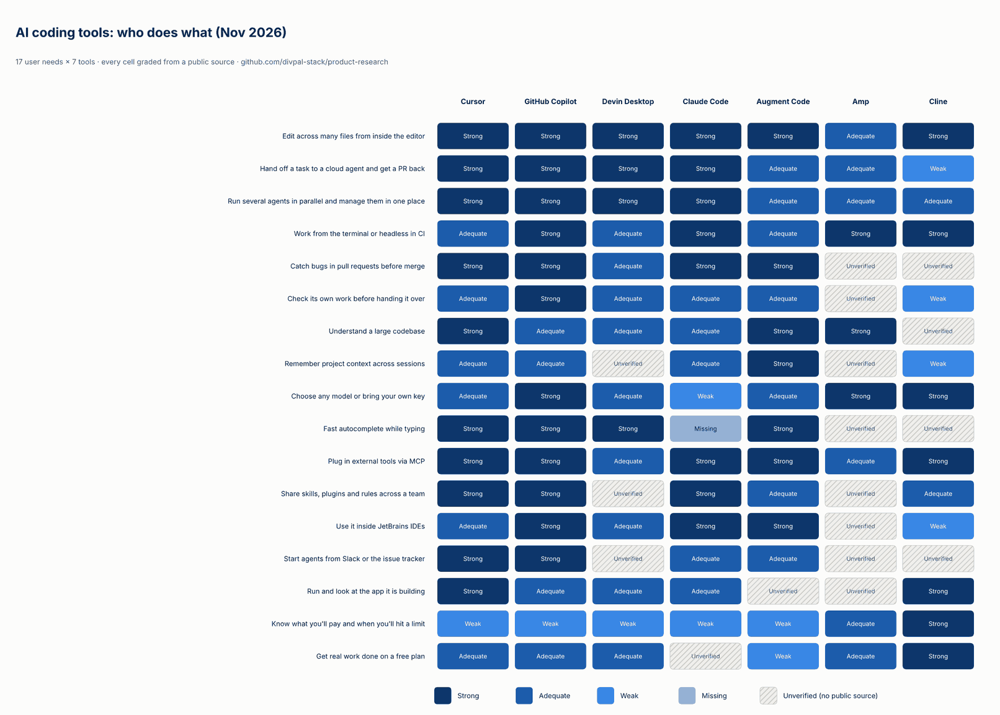

# What should each AI coding tool build next? (November 2026)

*Run: `research/examples/ai-coding-tools-2026-11` · Date: 2026-11-15 · Products: Cursor, GitHub Copilot, Devin Desktop, Claude Code, Augment Code, Amp, Cline*

> **Method in one line:** 17 user needs × 7 tools, every cell graded from a public source ([matrix.csv](matrix.csv)), demand from developer surveys and review syntheses ([reviews.csv](reviews.csv)), ranked by `scripts/score_gaps.py` with default weights. No vendor accounts, no hands-on testing, no affiliation with any vendor.

## TL;DR

- **The market consolidated in 2026.** SpaceX bought Cursor, which has been sold inside "The X Subscription" with Grok and X Premium since October 12 ([x.ai](https://x.ai/news/x-subscription)). Windsurf became Devin Desktop on June 2 ([Devin docs](https://docs.devin.ai/desktop/devin-desktop-faq)). Amp spun out of Sourcegraph and paused its free tier ([Tech Insider](https://tech-insider.org/amp-vs-claude-code-vs-cursor-2026/)).
- **Cloud agents, parallel agents and MCP are now table stakes.** At least four of the seven tools are rated strong on each. They're no longer a reason to pick one tool over another.
- **The biggest unmet need is a price you can predict.** Five of seven tools grade *weak*. About 30% of engineers in the Pragmatic Engineer's 2026 survey had hit usage limits ([source](https://newsletter.pragmaticengineer.com/p/the-impact-of-ai-on-software-engineers-2026)). Only the bring-your-own-key tools do well here: Cline (strong) and Amp (adequate).
- **Verification is the open lane.** Only GitHub Copilot is strong at checking its own work (self-review plus security scanning). Meanwhile, "almost right, but not quite" has been developers' top AI frustration since Stack Overflow's 2025 survey ([source](https://stackoverflow.blog/2025/07/29/developers-remain-willing-but-reluctant-to-use-ai-the-2025-developer-survey-results-are-here/?cb=1)).

## What each tool should build next

Top three gaps per tool by priority score, leaving out rows where the tool's own grade couldn't be verified. Full rankings are in [gaps.md](gaps.md).

| Tool | Build next | Where it already leads |
|---|---|---|
| **Cursor** | 1. Predictable pricing (now a shared Grok/Cursor weekly pool) · 2. Model choice (Claude and other third-party models cost extra) · 3. Self-check before handoff | No outright lead, but strong on 10 of 17 needs |
| **GitHub Copilot** | 1. Predictable pricing (moved to usage-based billing in April) · 2. Large-codebase understanding · 3. A more useful free plan | **Checks its own work** (only tool rated strong); strong on 12 of 17 needs, the most of any tool |
| **Devin Desktop** | 1. Predictable pricing (daily/weekly quotas, overage at API rates) · 2. Large-codebase understanding · 3. Model choice | No outright lead; 3 needs unverified |
| **Claude Code** | 1. Model choice (Anthropic models only) · 2. Predictable pricing (rate-limit drain is a recurring complaint) · 3. Inline autocomplete | No outright lead; strong on terminal, cloud agents, review and extensibility |
| **Augment Code** | 1. Predictable pricing (credit-based) · 2. A free plan · 3. Model choice | **Memory across sessions** (only tool rated strong) |
| **Amp** | 1. Managing parallel agents in one place · 2. Predictable pricing · 3. A free plan without your own keys | No outright lead; **8 of 17 needs unverified**, the most opaque of the seven publicly |
| **Cline** | 1. Self-check before handoff · 2. Memory across sessions · 3. Hosted cloud agents that return a PR | **Price predictability and free use** (open source, pay inference at cost) |

## Where nobody is great yet

| Need | Best grade anyone gets | Demand signal | Why it's open |
|---|---|---|---|
| Know what you'll pay and when you'll hit a limit | Strong (Cline only) | 6 independent sources, strongly negative | Every subscription tool is weak; only BYOK tools escape it |
| Check its own work before handing it over | Strong (Copilot only) | 3 sources, including Stack Overflow's top frustration | Most tools review PRs *after* the fact rather than verifying before handoff |
| Remember project context across sessions | Strong (Augment only) | 2 sources | Most rely on hand-written rule files (CLAUDE.md, .clinerules) |

## Blind spots

- **17 of 119 cells (14%) are unverified.** Amp accounts for 8, Cline 4, Devin Desktop 3, Claude Code 1 and Augment 1. These tools may well have these features. They just weren't documented in the public sources read.
- **Mixed source quality.** Grades lean on vendor docs and changelogs where possible, but many cells cite third-party reviews and roundups, which can be stale or promotional. Every grade links its source so it can be checked or challenged.
- **Demand counts are small.** `mentions` in `reviews.csv` counts independent sources read *in this run* that flag the need (surveys, review syntheses, threads), not individual reviews. Treat it as directional.
- **No hands-on testing.** Nothing here measures quality, speed or accuracy. It covers which capabilities exist and how well they're documented and reported.
- **"Missing" for Claude Code autocomplete** is based on the feature's absence from the docs index, not an explicit statement.

## Method

- **Sources read:** vendor docs and changelogs, GitHub/xAI/Cognition announcements, independent reviews and roundups, Pragmatic Engineer and Stack Overflow surveys, Reddit sentiment syntheses. All links are in `matrix.csv` and `reviews.csv`.
- **Lookback:** mostly January to November 2026.
- **Scoring:** `scripts/score_gaps.py` defaults (weights 0.40 gap / 0.30 coverage / 0.30 demand; effort M for everything), run once per tool as the focal product. Tools whose own grade is `unknown` get the label **Unverified** and aren't reported as missing.

*Spotted a wrong grade? Open an issue or PR with a better source. That's the point of keeping the evidence in a CSV.*
