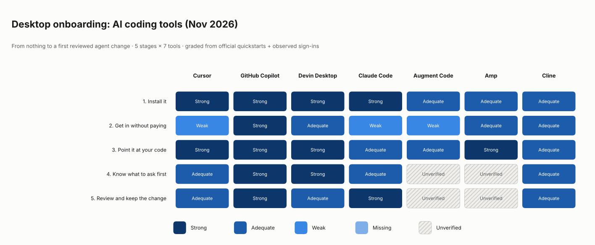

# Desktop onboarding teardown: AI coding tools (November 2026)

*Journey: **from nothing to a first reviewed agent change, on a laptop** · Run: `research/examples/desktop-onboarding-2026-11` · Date: 2026-11-15*

> **Method:** five stages graded from each tool's official quickstart, plus two first-hand sign-in attempts (Cursor and Devin, Nov 15, 2026) marked `evidence_type: logged-in` in [journey.csv](journey.csv). Ranked with `scripts/score_gaps.py`. No accounts were created to test paid flows, and nothing was timed.

## Verdict

**GitHub Copilot's desktop app has the best-documented first run.** It's the only tool rated strong at all five stages. What sets it apart: it lets you in without a paid plan (sign up, or bring your own model key, right in the app), pre-lists repos from your recent GitHub activity, hands you a safe first prompt, and turns the result into a pull request in one click.

| Stage | Best in class | What they do that others don't |
|---|---|---|
| 1. Install it | Cursor, Copilot app, Devin Desktop, Claude Code | A standalone app. No editor or runtime to install first |
| 2. Get in without paying | **Copilot app** | No plan? Choose "sign up" or "use my own model provider" inside the app |
| 3. Point it at your code | **Copilot app**, Cursor, Devin Desktop, Amp | Copilot pre-lists *your recent repos*; Amp needs no local checkout (cloud orb) |
| 4. Know what to ask first | **Copilot app**, Devin Desktop | A ready-made, low-risk first prompt you can click |
| 5. Review and keep the change | **Copilot app**, Claude Code | Copilot: diff, then one-click PR. Claude Code: approve or decline each change, comment on lines, `/code-review` |

## What each product should change

Fixes are ordered by priority score. Each one points to the product that already does it well.

### Cursor
1. **Don't send new sign-ups to a checkout.** On Nov 15, signing in at cursor.com/dashboard landed on a Premium checkout (`/unify/upgrade`, "50% off for 1 month"). Land people on the free X Subscription tier and ask for the upgrade after their first success, the way Copilot puts "sign up" and "bring your own key" side by side.
2. **Make sign-in work without a Grok popup.** The same page tried to open a "Sign in with Grok" popup, which a blocked popup turns into a dead end. Default to a sign-in that redirects in the same window (email, GitHub, Google).
3. **Put the quickstart's best idea in the product.** The docs suggest asking Agent for "three small, safe improvements". Show that as a clickable first-run prompt, as Copilot and Devin do.
4. **End the first run with an explicit "keep it" step.** The quickstart ends at "review the diff, run checks". Add an accept, commit or PR action so new users know when they're done.

### GitHub Copilot app
1. **Fix the docs that contradict each other.** The features page says the app comes with every plan, including Free. Some help pages still say Free users don't have access or that there's a waitlist. New users who land on the wrong page will give up.
2. **Handle the Git prerequisite inside the app.** Detect missing Git and offer to install it, rather than leaving it as a docs prerequisite.

### Devin Desktop (formerly Windsurf)
1. **Fix the web onboarding dead end.** On Nov 15, logging in through the old Windsurf URL led to "Connect your Git provider" with no visible button and 400/404 errors in the console. Every onboarding step needs a visible **Skip**.
2. **Move the setup screens after the first win.** Theme, settings import, an intro video and a plugin card all come before the first task. Copilot asks for the theme *after* repos are connected. Ask for preferences once there's something to customize.
3. **Show how to review the first change.** Quick Review exists, but onboarding never mentions it. Copy Copilot's ending: **Changes → Create PR**.

### Claude Code (desktop)
1. **Let new users see one session before paying.** Clicking the Code tab on a free account shows an upgrade prompt. A one-task trial, or Copilot-style "bring your own key", would let people see the excellent review flow before deciding to pay.
2. **Merge environment and folder into one step.** First-run users pick "Local" in one control, then "Open folder…" in another. Preselect Local and lead with a single **Open folder** button.
3. **Show the example prompts in the product.** The docs already list good first tasks ("Find a TODO comment and fix it", "Add tests for the main function"). Put them as clickable chips under the prompt box, as Devin does.
4. **Install Git automatically on Windows.** Today it's a prerequisite that requires a restart.

### Augment Code
1. **Say plainly how to get in for free.** No permanent free plan is listed. Offer a clear trial or bring-your-own-key path on the install page.
2. **Use the indexing wait as the first-task moment.** Once Sync finishes, suggest a task based on the repo ("Here's how your services connect. Try: …"). The Context Engine is the selling point, so this is the place to show it.
3. **Add a review step to the quickstart.** First-change review isn't covered.

### Amp
1. **Document the first prompt and the review step for orbs.** Getting started covers signing in and creating a project, then stops.
2. **Be upfront about Mac requirements.** The Mac app needs macOS 26 or later. Point older Macs to the web app so it isn't a dead end.
3. **Make the free path obvious at sign-up.** The free tier is paused, and "free with your own keys" isn't mentioned until later.

### Cline
1. **Don't make newcomers choose a model provider first.** Default to "Sign in with Cline" (no API key) and keep provider/BYOK as an advanced option.
2. **Suggest a safe first task in the sidebar.** Today it's a separate tutorial (build a todo app). A one-click "small, low-risk change in this repo" is quicker.
3. **Reduce approval fatigue on small tasks.** Approving every file change and command is Cline's safety model, but frequent approvals are the top complaint (cited in 65 reviews). Offer "approve all edits for this task" for small diffs.

## Patterns worth copying, whatever you're building

- **Let people in for free, and ask for money after.** The two tools that open with a paywall or checkout (Claude Code, and Cursor's observed flow) are weakest at stage 2.
- **Pre-fill from what you already know.** Copilot uses your GitHub history to list repos. Nobody else does.
- **Give the first prompt.** A blank prompt box is the hardest moment in onboarding. The two strongest tools fill it for you.
- **End with something to keep.** A PR, commit or approval tells new users the job is done. Diff-only endings leave them unsure.

## Blind spots

- **4 of 35 stage grades are unverified** (Augment and Amp stages 4–5). Their official getting-started pages don't cover those stages publicly.
- **Mostly docs, not usage.** Grades reflect the *documented* first run. The live product may do more or less. The two `logged-in` observations came from one person in an embedded browser that blocks popups, which may have made the Cursor sign-in look worse than it is.
- **Nothing was timed**, and the paid tiers weren't tested.
- **Surfaces differ.** Augment and Cline are extensions; Amp is web/cloud-first. "Install" grades reflect that extra prerequisite, not product quality.

*Run this for your own product: see [skills/journey-teardown](../../../skills/journey-teardown/SKILL.md).*
